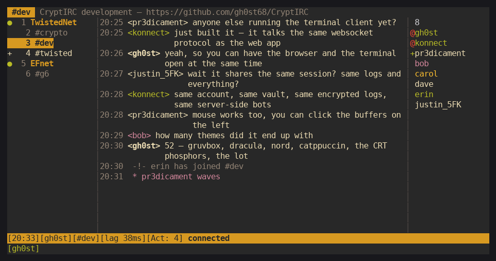
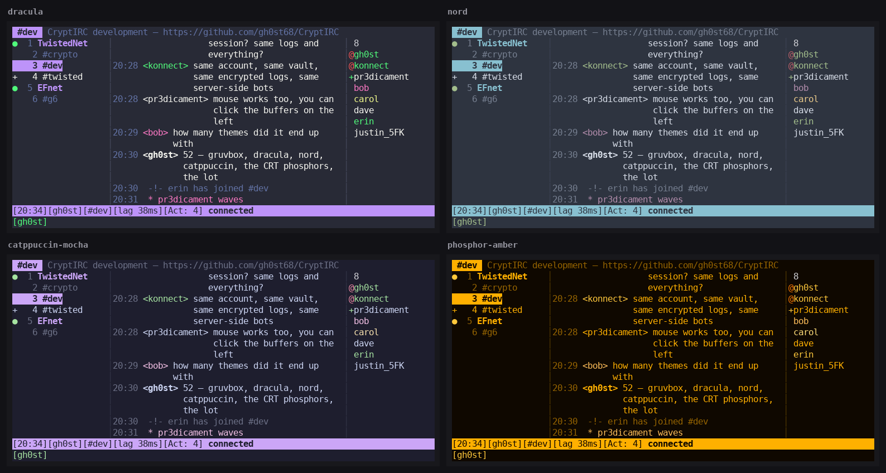
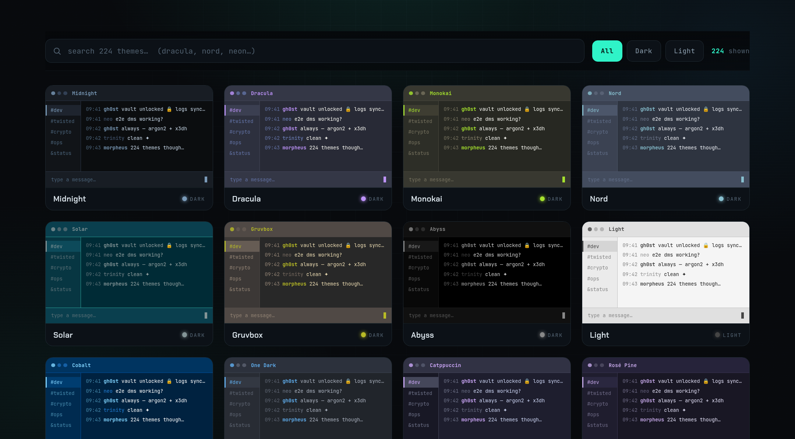

<p align="center">
  
</p>

<h1 align="center">CryptIRC</h1>

<p align="center"><strong>IRC that stays connected.</strong><br>Self-hosted. Encrypted history. All your devices.</p>

<p align="center">
  <a href="https://github.com/gh0st68/CryptIRC/releases/latest"></a>
  
  
</p>

<p align="center">
  <a href="https://client.twistednet.org/cryptirc"><strong>Open the web client</strong></a> &nbsp;·&nbsp;
  <a href="https://github.com/gh0st68/CryptIRC/releases/latest">Download an app</a> &nbsp;·&nbsp;
  <a href="https://cryptirc.com/">Website</a> &nbsp;·&nbsp;
  <a href="https://gh0st68.github.io/CryptIRC/">Theme gallery</a>
</p>

<p align="center">
  
</p>

CryptIRC keeps your IRC networks connected on your server while you move between devices. Catch up on encrypted history, join the conversation from a browser or app, and make the interface your own.

The web server and IRC daemon run separately, so routine web updates can leave your IRC connections running.

**[Get started](#get-started)** · **[Clients](#clients)** · **[Features](#features)** · **[Privacy](#privacy-and-encryption)** · **[Commands](#commands-and-shortcuts)** · **[Configuration](#configuration)**

<a id="quick-start"></a>
<a id="deployment"></a>

## Get started

**Use the hosted client:** open [client.twistednet.org/cryptirc](https://client.twistednet.org/cryptirc) and create an account. You can add TwistedNET and other IRC networks from the same client.

**Run your own server:** on Debian or Ubuntu, clone the repository and run the interactive installer:

```bash
git clone https://github.com/gh0st68/CryptIRC.git
cd CryptIRC
sudo bash deploy/deploy.sh
```

The installer walks through the domain or IP address, HTTPS, registration options, and first-user setup. It installs the Rust services, Caddy, and systemd units. Email setup is optional.

For Arch Linux, use `sudo bash deploy/deploy-arch.sh` instead.

See the [installation guide](INSTALL.md), [deployment notes](deploy/README.md), or [web install and update guide](https://cryptirc.com/install/) for requirements, manual installation, and updates. For a source build, use the current stable Rust toolchain.

<a id="available-everywhere"></a>
<a id="terminal-client"></a>
<a id="️-terminal-client"></a>

## Clients

| Where you chat | How to use it |
| --- | --- |
| **Browser** | Open the [hosted client](https://client.twistednet.org/cryptirc), or your own CryptIRC instance. |
| **Windows** | Download the [desktop installer](https://github.com/gh0st68/CryptIRC/releases/latest). |
| **macOS** | Download the [Mac archive](https://github.com/gh0st68/CryptIRC/releases/latest), extract it, and move the app to Applications. Intel and Apple Silicon builds are available. |
| **Linux desktop** | Download the [AppImage](https://github.com/gh0st68/CryptIRC/releases/latest), make it executable, and run it. |
| **Android** | Open the client in a compatible browser and choose **Add to Home Screen** or **Install app**. |
| **iPhone / iPad** | Open the client in Safari, then choose **Share → Add to Home Screen**. |
| **Terminal / SSH / tmux** | Build and run [cryptirc-tui](tui/README.md). It can share an account with the web client. |

Desktop releases support 64-bit Windows, macOS 13 or newer (Intel / Apple Silicon), and Linux.

<details>
<summary><strong>See mobile and terminal previews</strong></summary>

<p align="center">
  
</p>

The terminal client includes a network and channel list, wrapped scrollback, a member list, mouse support, and tab completion. It has **52 terminal themes**, switchable with `/theme`.

<p align="center">
  
</p>

```bash
cd tui
cargo build --release
./target/release/cryptirc-tui -s https://your.server/cryptirc -u yournick
```

<p align="center">
  
</p>

[Terminal setup, commands, and key bindings →](tui/README.md)

</details>

<a id="key-features"></a>

## Features

| | What you get |
| --- | --- |
| **Stay connected** | Multiple IRC networks, encrypted history, reconnect handling, and a separate IRC daemon that survives routine web-server updates. |
| **Pick up anywhere** | Desktop apps, an installable mobile PWA, a terminal client, synced preferences, favorites, and unread markers. |
| **Follow the conversation** | Unified Messages inbox, searchable history, Notices with message jumps, push alerts, custom highlights, mutes, and quiet hours. |
| **Make it yours** | 227 themes, including 64 animated themes and classic IRC client skins, 140 font choices, editable palettes, backgrounds, and resizable columns. |
| **Share more** | Inline images, video and audio, a GIF picker, link previews, file uploads, text / HTML / Markdown pastes, and a URL shortener. |
| **Use familiar IRC tools** | SASL PLAIN/EXTERNAL, IRCv3 capabilities, nick monitoring, channel modes, moderation tools, and slash-command completion. |

### Your IRC, your look

Choose from **227 themes**: 163 static and 64 animated. There are editor favorites such as Dracula and Nord, classic mIRC / HexChat / XChat / irssi skins, illustrated backgrounds, and quieter minimal palettes.

Customize a theme into your own saved copy, adjust fonts and column widths, or add a background image with opacity, blur, dim, and tiling controls. Mobile theme and layout overrides let your phone have its own setup. Optional desktop pets add a little company, with motion controls for quieter sessions.

<p align="center">
  <a href="https://gh0st68.github.io/CryptIRC/"></a>
</p>

[Browse the theme gallery →](https://gh0st68.github.io/CryptIRC/)

### Optional AI and bots

Connect a supported AI provider or an OpenAI-compatible endpoint for channel, DM, or private `/ai` conversations. Opt-in context and bounded IRC actions let the assistant work with your channels; provider requests go to the service you configure.

The server also includes **19 bots** for weather, lookups, quotes, seen records, offline tells, notes, and other utilities. Bot controls include triggers, access rules, cooldowns, and per-channel settings. Channel protection adds auto-op/voice, flood controls, and word filtering.

<details>
<summary><strong>Detailed IRC, interface, and admin features</strong></summary>

#### IRC and IRCv3
- IRC support — channels, DMs, modes, kicks, bans, CTCP, the works
- **IRCv3 capabilities** (17 user-toggleable): away-notify, account-notify, extended-join, server-time, multi-prefix, cap-notify, message-tags, batch, echo-message, invite-notify, setname, account-tag, userhost-in-names, chghost, labeled-response, typing indicators, standard-replies (plus SASL, negotiated separately; nick MONITOR is a separate feature)
- **IRCv3 CAP toggle** — enable/disable individual capabilities per network in settings
- **SASL PLAIN & EXTERNAL** authentication
- Multi-network support — connect to multiple networks simultaneously
- **Nick monitoring** — track when users come online/offline with push notifications
- **KeepNick** — irssi-style nick keeper with ISON polling, QUIT/NICK event detection, and auto-reclaim
- **Auto-identify** — automatically send NickServ IDENTIFY on connect (encrypted credential storage)
- **Auto-rejoin on kick** — automatically rejoin channels after being kicked (with saved channel keys)
- **Channel key manager** — store and auto-send channel keys (+k) when joining
- **Multi-device sync** — messages you send on one device appear on all your other devices
- **Typing indicators** — see when someone is typing (IRCv3 draft/typing)
- **Server-time** — accurate timestamps from the IRC server
- **ZNC playback detection** — detects and batches ZNC buffer playback with summary markers
- **Self-signed cert detection** — popup warning with one-click fix for ZNC/bouncer TLS errors
- **Status message condensing** — Lounge-style grouped join/part/quit (Show All / Condense / Hide)
- Configurable join/part/quit message filtering
- **Infinite scroll** — load older messages from encrypted server logs on demand

#### Chat and interface
- **Lounge-style layout** — clean input bar, grouped nick list, collapsible panels
- **Mobile-first PWA** — installable on iOS/Android with swipe gestures and safe-area support
- **iOS PWA keyboard handling** — adapts to the iOS keyboard and accessory bar
- **Collapsible panels** — sidebar and nick list collapse on desktop with persistent state
- **Nick list grouped by role** — Owners, Admins, Operators, Half-Ops, Voiced, Users
- **Nick context menu** — whois, query, slap, monitor, notes, kick/ban/voice/op based on power level
- **Clickable nicks in messages** — nick mentions in chat text are colored and clickable
- **Smart tab completion** — prioritizes most recent speakers, with Tab cycling
- **@nick autocomplete** — type `@` to search and insert channel nicks
- **#channel autocomplete** — type `#` to autocomplete channel names
- **Inline media previews** — images, videos (.mp4/.webm/.mov), YouTube rich cards with title/author
- **Inline audio player** — .mp3, .ogg, .flac, .wav, .m4a, .aac, .opus with playback controls
- **GIF picker** — type `/gif <search>` (or `/giphy`) for a smooth in-line grid of results, navigable by tap or arrow keys + Enter. Powered by **Giphy or Tenor** — the admin picks the provider and can set a shared key so it works for everyone with no setup, or each user can supply their own
- **Image lightbox** — click to zoom, scroll wheel zoom, pinch-to-zoom on mobile, pan when zoomed
- **Link previews** — server-side metadata fetcher with admin whitelist (SSRF protected)
- **Pastebin** — share text snippets with password protection and expiration
- **URL shortener** — built-in `/shorten` command creates short redirect URLs with interstitial page
- **Smart paste** — paste multi-line text and it auto-offers "send as pastebin?" instead of flooding
- **Split view** — view two channels side by side on desktop (`/split`)
- **Read markers** — "new messages since you were away" divider line in channels
- **User notes** — attach private notes to any nick (right-click menu or `/note`)
- **Seen database** — `/seen nick` tracks last message time and channel
- **Channel stats dashboard** — most active users with bar chart (`/stats`)
- **ASCII art generator** — `/ascii text` sends block-letter art to channel
- **Urban Dictionary** — `/ud word` looks up and sends definitions
- **DND mode** — Do Not Disturb with scheduled quiet hours (`/dnd`)
- **Encrypted notepad** — private auto-saving notes, encrypted with vault key
- **mIRC color formatting** — Ctrl+K color picker, Ctrl+B/U/I/O for bold/underline/italic/reset
- **Topic bar** with mIRC color rendering and edit/copy/view menu
- **Emoji picker** with colon autocomplete (`:wave:` style)
- **Slash command autocomplete** — type `/` to see all 100+ commands
- **Search** — search messages in current channel with highlighted results
- **File uploads** — drag-and-drop or paperclip, with automatic metadata stripping for images, video, and audio (configurable max size from admin panel)
- **My Uploads panel** — view, manage, and delete your uploaded files
- **Desktop and mobile notifications** — background Web Push, foreground alerts, per-conversation mutes, and Do Not Disturb
- **Smart unread badges** — gray for regular messages, red for mentions and DMs
- **Notices panel** — mentions and unread PMs, with links to the matching message
- **Custom highlight words** — tag-based UI to add/remove trigger words for notifications
- **Synced preferences** — themes, favorites, unread markers, notices, notes, and saved keys
- **Network drag-and-drop** — reorder networks with all their channels (desktop drag + mobile hold-to-drag)
- **Channel drag-and-drop** — reorder channels within a network
- **Favorites filter** — funnel icon filter bar to show only favorited channels
- **Messages inbox** — an optional pinned tab at the top of the sidebar that gathers every DM from all your networks into one unified inbox, iMessage-style (toggle in Appearance ▸ Messages tab)
- **Encryption indicators** — SVG lock/unlock icons on every channel and DM in the sidebar
- **Mobile lag indicator** — ping time shown next to channel name in topbar
- **SVG icon settings menu** — clean Lucide-style line icons, scrollable on small screens
- **Standalone security panel** — vault auto-lock, message expiry, rate limit, PM blocking, spellcheck, link previews
- **140 font choices** — monospace, sans-serif, serif, display, and cursive/handwriting, mostly from Google Fonts
- **Clear all data** — one-click deletion of logs, notepad, and pastes with confirmation

#### Administration
- **Admin panel** — user management, live stats (total / online), registration settings
- **GIF Picker settings** — choose the provider (**Giphy** or **Tenor**), the mode (Off / per-user own-key / shared server key), and store the server-held Giphy + Tenor API keys (never exposed to users)
- **Max upload size** — admin-set per-file upload cap (1–500 MB)
- **Link preview controls** — pick a mode (Off / Whitelist approved-domains-only / All HTTPS links, with private IPs blocked) plus the domain whitelist
- **Registration modes** — open, invite-code, or closed (persists across reboots)
- **User management** — disable, delete, promote to admin, toggle upload permission
- **All admin settings persist** to disk with mutex protection (survives server restarts)

</details>

<a id="encryption--security"></a>

## Privacy and encryption

CryptIRC provides encryption for stored data and optional end-to-end protection for conversations. These protect different parts of the system.

| Protection | Scope |
| --- | --- |
| **Encrypted storage** | Per-user vaults protect chat logs, saved IRC credentials, and private notes with AES-256-GCM. Argon2id protects the vault master key. |
| **End-to-end encrypted DMs** | Compatible clients can use Signal Protocol encryption with X3DH and Double Ratchet. Enable E2E for the conversation. |
| **Shared channel encryption** | Optional AES-256-GCM encryption uses a shared channel key. |
| **IRC connection security** | TLS and SASL PLAIN/EXTERNAL support, with client certificate management and a guard against sending SASL PLAIN over an unencrypted connection. |
| **Account controls** | Vault locking, configurable auto-lock, session revocation, PM blocking, and administrative account controls. |

The server handles ordinary IRC traffic and unlocks the storage vault, so run CryptIRC on a server you trust. Encrypted storage does **not** make ordinary IRC traffic end-to-end encrypted or make the server unable to read unlocked data. AI providers, GIF services, and link previews are optional external integrations.

## Commands and shortcuts

Type `/` in the composer to browse commands, or use `/help` for the in-app reference.

| Start with | Action |
| --- | --- |
| `/join #channel` | Join a channel. |
| `/query nick` | Open a private conversation. |
| `/whois nick` | Look up a user. |
| `/dnd on` | Enable Do Not Disturb. |
| `/split` | Open a second conversation beside the first. |
| `Tab` | Complete a nickname. |
| `@`, `#`, `:` | Find nicknames, channels, or emoji. |

<details>
<summary><strong>Full command and keyboard reference</strong></summary>

All 100+ commands show in the `/` autocomplete dropdown. Type `/` to browse.

**Channel:**

| Command | Description |
|---------|-------------|
| `/join #channel [key]` | Join a channel (auto-adds # if missing) |
| `/part [#channel] [reason]` | Leave a channel |
| `/cycle` | Part and rejoin channel |
| `/topic [text]` | View or set channel topic |
| `/list` | List all channels on the server |
| `/links` | Show server links |
| `/invite nick` | Invite user to channel |
| `/names` | Refresh the nick list |
| `/key #channel [key]` | Save or clear a channel key (+k) |

**Messaging:**

| Command | Description |
|---------|-------------|
| `/msg nick text` | Send a private message |
| `/query nick [text]` | Open a DM window |
| `/me text` | Send an action |
| `/say text` | Send raw text to current target |
| `/notice nick text` | Send a notice |
| `/ctcp nick command` | Send a CTCP command |
| `/slap nick` | Slap someone with a large trout |

**Identity & Info:**

| Command | Description |
|---------|-------------|
| `/nick newnick` | Change your nickname |
| `/away [message]` | Set away status |
| `/back` | Remove away status |
| `/whois nick` | Look up user info |
| `/whowas nick` | Look up offline user |
| `/who #channel` | List users in a channel |

**User Modes:**

| Command | Description |
|---------|-------------|
| `/mode +mode [args]` | Set channel or user mode |
| `/op` `/deop` | Give/remove operator (+o) |
| `/voice` `/devoice` | Give/remove voice (+v) |
| `/halfop` `/dehalfop` | Give/remove half-op (+h) |
| `/admin` `/deadmin` | Give/remove admin (+a) |
| `/owner` `/deowner` | Give/remove owner (+q) |

**Mass Operations:**

| Command | Description |
|---------|-------------|
| `/opall` | Op everyone in the channel |
| `/deopall` | Deop everyone |
| `/mdop` (aliases `/massdeop`, `/drop`) | Strip ALL status (~&@%+) from everyone except you |
| `/voiceall` `/devoiceall` | Voice/devoice everyone |
| `/kickall` | Kick everyone except yourself |

**Moderation:**

| Command | Description |
|---------|-------------|
| `/kick nick [reason]` | Kick a user |
| `/ban nick` | Ban a user (nick!*@*) |
| `/unban mask` | Remove a ban |
| `/kickban nick [reason]` | Kick and ban |
| `/tban nick seconds` | Temporary ban with auto-unban |
| `/banlist` | View the ban list |
| `/unbanall` | Remove ALL bans from channel |
| `/unexemptall` | Remove all ban exempts (+e) |
| `/ignore nick\|mask` | Ignore a user (supports wildcards) |
| `/unignore nick\|mask` | Stop ignoring a user |
| `/ignorelist` | Show your ignore list |

**Services:**

| Command | Description |
|---------|-------------|
| `/ns command` | Send to NickServ |
| `/cs command` | Send to ChanServ |
| `/identify password` | Identify with NickServ |
| `/register password email` | Register with NickServ |
| `/ghost nick` | Ghost a nick |
| `/regain nick` | Recover/regain a nick |

**IRCOp:**

| Command | Description |
|---------|-------------|
| `/oper login password` | Authenticate as IRCOp |
| `/kill nick reason` | Kill a user from the network |
| `/shun` `/gline` `/zline` `/kline` | Server bans with duration/reason |
| `/rehash` | Reload server configuration |
| `/squit server reason` | Disconnect a linked server |

**Encryption:**

| Command | Description |
|---------|-------------|
| `/encrypt keygen` | Generate Signal protocol identity |
| `/encrypt on` | Enable E2E for current DM |
| `/encrypt off` | Disable E2E for current DM |
| `/encrypt add #channel` | Set a channel encryption key |
| `/encrypt rotate` | Rotate your E2E keys |

**Tools:**

| Command | Description |
|---------|-------------|
| `/ascii text` | Generate ASCII block-letter art |
| `/ud word` | Urban Dictionary lookup (sends to channel) |
| `/gif query` (alias `/giphy`) | Search a GIF and send the top match; add a trailing space to open the live picker; `/gif key <k>`, `/gif rating <g\|pg\|pg-13\|r>` — Giphy or Tenor (admin-selectable) |
| `/shorten url` | Shorten a URL with built-in shortener |
| `/stats` | Channel statistics dashboard (top talkers) |
| `/note nick [text]` | Set or view private notes on a nick |
| `/seen nick` | When a nick was last seen and where |
| `/dnd on\|off` | Toggle Do Not Disturb mode |
| `/dnd schedule HH:MM HH:MM` | Schedule quiet hours |
| `/split` | Toggle split view (two channels side by side) |
| `/keepnick [nick]` | Keep a nick (auto-reclaim via ISON + events) |
| `/unkeepnick` | Stop keeping a nick |
| `/listnick` | List all kept nicks with status |
| `/ratelimit ms` | Set message rate limit (default 500ms) |
| `/expire hours` | Auto-delete old messages (0 = off) |
| `/autolock minutes` | Vault auto-lock after inactivity (0 = off) |

**Connection:**

| Command | Description |
|---------|-------------|
| `/connect` | Connect to the current server |
| `/disconnect` | Disconnect from the current server |
| `/quote text` | Send a raw IRC command |

**Client:**

| Command | Description |
|---------|-------------|
| `/close` | Close the current DM or channel tab |
| `/clear` | Clear current chat history |
| `/clearall` | Clear ALL chat buffers |
| `/help` | Show help panel with all commands |
| `/ping nick` | CTCP ping a user |
| `/version nick` | CTCP version a user |
| `/time nick` | CTCP time a user |
| `/monitor nick` | Monitor nick online/offline |
| `/unmonitor nick` | Stop monitoring |
| `/advertise` (alias `/ad`) | Post the CryptIRC promo banner to the current channel |

**Fun & Emotes:**

| Command | Output |
|---------|--------|
| `/prism text` · `/prism on\|off` | Rainbow mIRC colored text, or toggle rainbow for all your outgoing messages |
| `/color <fg>[,<bg>]` · `/color off` | Set a persistent mIRC colour for your messages (codes 0–15 or names like red, blue) |
| `/shrug` | ¯\\\_(ツ)\_/¯ |
| `/tableflip` | (╯°□°)╯︵ ┻━┻ |
| `/unflip` | ┬─┬ノ( º \_ ºノ) |
| `/lenny` | ( ͡° ͜ʖ ͡°) |
| `/disapprove` | ಠ\_ಠ |
| `/rage` | (ノಠ益ಠ)ノ彡┻━┻ |
| `/bear` | ʕ•ᴥ•ʔ |
| `/sparkle text` | ✧･ﾟ: \*✧ text ✧\*:･ﾟ✧ |
| `/finger` | ╭∩╮(︶︿︶)╭∩╮ |
| `/dance` | ♪┏(・o・)┛♪┗(・o・)┓♪ |
| `/rip name` | ⚰️ R.I.P. name ⚰️ |
| `/hug nick` | (づ｡◕‿‿◕｡)づ nick |

**Keyboard Shortcuts:**

| Shortcut | Action |
|----------|--------|
| `Ctrl+K` | mIRC color picker (16 colors, fg+bg) |
| `Ctrl+B` | Bold text |
| `Ctrl+U` | Underline text |
| `Ctrl+I` | Italic text |
| `Ctrl+O` | Reset formatting |
| `Tab` | Smart nick completion (most recent speaker first, cycles) |
| `@` | Nick autocomplete dropdown |
| `#` | Channel autocomplete dropdown |
| `:` | Emoji autocomplete |
| `/` | Slash command autocomplete (100+ commands) |
| `Escape` | Close autocomplete / overlays |
| `↑` / `↓` | Input history navigation |
| `Enter` | Send message |

</details>

<details>
<summary><strong>Settings panels</strong></summary>

Accessible from the sidebar gear menu:

| Panel | Contents |
|-------|----------|
| Notifications | Push alerts, desktop popups, sounds, trigger rules, custom highlight words (tag UI), per-network mute |
| Theme | 227 themes (64 animated), 140 fonts, customize any theme, font sizes, layout, display options, compact mode, colors, brightness, mobile overrides |
| Security | Vault auto-lock timer, message expiry, rate limit, block PMs (+g), auto-rejoin, link previews, spellcheck |
| Monitor | Nick online/offline tracking with push notifications |
| Notepad | Private encrypted auto-saving notes |
| Certs | Client TLS certificate management for SASL EXTERNAL |
| IRCv3 Caps | Toggle individual IRCv3 capabilities per network |
| Ignored Users | Manage ignore list (nick and wildcard mask support) |
| My Uploads | View, manage, and delete uploaded files with thumbnails |
| Sessions | View and revoke active sessions across devices |
| Vault Password | Change vault passphrase (re-encrypts all data) |
| Help | Complete command reference, features list, keyboard shortcuts |
| Admin | User management, registration settings, link-preview mode (off/whitelist/all), GIF picker (provider/mode/keys), max upload size |

</details>

## Architecture

The `cryptirc` web server handles the API, sessions, encrypted storage, uploads, and notifications. The `irc-core` daemon owns the IRC connections. A local Unix socket connects the two services.

```text
Browser / PWA / desktop app / terminal
                  │
          HTTPS + WebSocket
                  │
         cryptirc (Rust / Axum)
                  │
             Unix socket
                  │
       irc-core (persistent IRC)
                  │
           TLS / IRC networks
```

Routine web-server updates restart `cryptirc` while `irc-core` keeps running. Updating or stopping the IRC daemon itself can reconnect those IRC sessions.

| Layer | Technology |
| --- | --- |
| Server | Rust, Tokio, Axum |
| Web client | JavaScript, Web Crypto API, CSS custom properties |
| Desktop | Electron |
| Encryption | AES-256-GCM, Argon2id, HKDF-SHA256, Signal Protocol |
| Notifications | Web Push / VAPID and desktop notifications |
| Deployment | Caddy, systemd, optional Postfix integration |

## Configuration

| Variable | Default | Description |
|----------|---------|-------------|
| `CRYPTIRC_DATA` | `./data` | Path to the data directory |
| `CRYPTIRC_BASE_URL` | `http://localhost:9000` | Public URL of your instance |
| `CRYPTIRC_BASE_PATH` | `/cryptirc` | URL path prefix |
| `CRYPTIRC_PORT` | `9001` | Port the server listens on |
| `CRYPTIRC_HSTS` | `on` | Set to `off` to disable the HSTS header (for self-signed / bare-IP deployments) |
| `CRYPTIRC_FROM_EMAIL` | `noreply@cryptirc.local` | Sender address for emails |
| `CRYPTIRC_REGISTRATION` | `open` | Registration mode: `open`, `closed` |
| `CRYPTIRC_REG_CODE` | (none) | Invite code required for registration |
| `CRYPTIRC_IPC_SOCK` | `$CRYPTIRC_DATA/irc-core.sock` | Unix socket path between the web server and the `irc-core` daemon |
| `RUST_LOG` | `info` | Log level |

For registration, HTTPS, service configuration, and backups, see [INSTALL.md](INSTALL.md) and the [deployment guide](deploy/README.md).

## Community

Questions, bugs, or ideas? Join **#dev** or **#twisted** on `irc.twistednet.org` (TLS port **6697**), or [open a GitHub issue](https://github.com/gh0st68/CryptIRC/issues).

Built by **gh0st** at [TwistedNET](https://twistednet.org/).

## License

Proprietary. All rights reserved.
